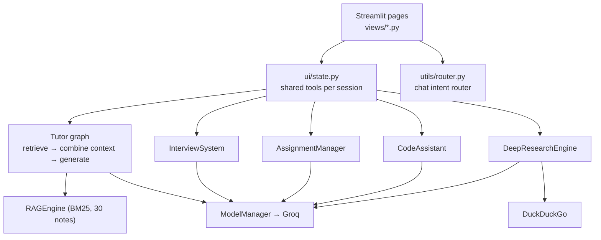

# Data Scientist BOT

An AI tutor for **data science, statistics, machine learning, Python, generative AI and agentic AI**, built with Streamlit, Groq and a retrieval-grounded tutor pipeline.

Made by **Himanshu**.

---

## What's inside

| Page | What it does |
| --- | --- |
| **Tutor Chat** | Ask anything. Answers are grounded in a curated 30-note knowledge base (BM25) and streamed as they are generated. Attach images, PDFs, code or CSVs. Responses show the intent, notes used and latency, plus 👍/👎 feedback. Typing `Research …`, `Fact-check: …`, or pasting code still works inline. |
| **Research & Fact-check** | Deep research runs 5 parallel DuckDuckGo searches and writes a cited briefing (downloadable as Markdown). Fact-check returns a verdict, confidence and evidence links. |
| **Code Lab** | Generate Python/SQL/R from a spec, or paste code for a bug-hunting review with a corrected version. |
| **Mock Interview** | Pick a track and difficulty; get 5 fresh questions, rubric scoring 0–10, strengths/gaps, a model answer each time and a final report with a chart. |
| **Assignments** | Generate 3–15 mixed questions + PDF, answer per question (or upload a file), get per-question scores and feedback. Saved assignments are listed in a history tab. |

---

## Run locally

```bash
python -m venv venv
venv\Scripts\activate            # macOS/Linux: source venv/bin/activate
pip install -r requirements.txt
copy .env.example .env           # then put your key in GROQ_API_KEY
streamlit run app.py
```

Optional `.env` settings (see `.env.example`): override model ids (`GROQ_REASONING_MODEL`, `GROQ_FAST_MODEL`, `GROQ_CODE_MODEL`, `GROQ_VISION_MODEL`). Tutor Chat automatically uses DuckDuckGo for explicit online-search requests and time-sensitive questions; set `SELF_RAG_WEB=0` to disable these lookups.

User-visible generated text, including tutor answers and image descriptions, is screened by a
separate Groq moderation model before it is shown. Tutor answers are generated as a stream
but withheld until the complete answer passes one moderation check; this avoids repeated
moderation calls for every sentence and prevents partial answers from being displayed before
the full output is checked. Moderation requests use a 15-second timeout. A valid
`GROQ_API_KEY` is therefore required for the tutor and moderation.
The default moderation model is `openai/gpt-oss-safeguard-20b`, Groq's recommended
replacement for the decommissioned Llama Guard model. Set `GROQ_MODERATION_MODEL`
to override it. If the configured model has been decommissioned, the app retries
moderation with `openai/gpt-oss-safeguard-20b`. Unsafe,
unrecognized, or unmoderated output is withheld (fail-closed), so a moderation
service/model failure also prevents generated answers from being displayed. This
adds one API request (with a single retry for supported transient rate limits) and
latency to each displayed response.
Structured outputs use smaller token budgets to avoid reserving more tokens than
the provider's per-minute allowance. On a model rate limit, the app tries the
configured fast model once and reports any provider reset hint if that also fails.

`DSBOT_MOCK=1 streamlit run app.py` starts the UI with an offline fake model (no key needed) for UI work.

---

---

## Architecture



```text
app.py                  entry point: navigation, sidebar, theme
views/                  one file per page (chat, research, code_lab, interview, assignments)
ui/theme.py             stylesheet + small HTML components
ui/state.py             cached model/RAG, per-session tools, uploads, feedback log
utils/model_manager.py  Groq client: retries, reasoning_effort, strict-JSON, usage tracking
utils/router.py         intent classification for the chat box
utils/rag_engine.py     knowledge base + BM25 with relevance thresholds
utils/self_rag_graph.py LangGraph Self-RAG
utils/interview.py      question banks, rubric scoring
utils/assignment.py     question banks, PDF, per-question grading
utils/code_assistant.py code generation / review
utils/deep_research.py  parallel web research, fact-check
utils/image_recognition.py vision model with fallbacks
evals/mock_model.py     offline fake model for local UI work
```

### Models

| Role | Default | Used for |
| --- | --- | --- |
| `reasoning` | `openai/gpt-oss-20b` | tutor answers, interview, grading, research |
| `fast` | `openai/gpt-oss-20b` | structured checks and optional web-result grading |
| `code` | `openai/gpt-oss-120b` | code generation and review |
| vision | `GROQ_VISION_MODEL` (optional), then `qwen/qwen3.8-27b` | image attachments |

Tutor Chat uses Groq only, with `openai/gpt-oss-20b` as the default answer model.
Tutor answers use temperature 0.2 and a 4,096-token budget, and are generated in
one streaming model call after retrieval. Instructions favor complete, step-by-step
explanations while prioritizing supported facts and admitting uncertainty. There is
no per-answer LLM reviewer or automatic quality retry. Numeric questions use the
same tutor-model path. The standalone fixed-deposit helper uses monthly
compounding, end-of-month deposits, and annual tax on interest before reinvestment;
it is not part of Tutor Chat.

### Prompt-injection safeguards

Model calls use a shared security policy that instructs the model not to reveal
hidden instructions or secrets and treats uploaded files, retrieved notes, web snippets,
images/OCR, code comments, and prior conversation as untrusted data. Source material
and conversation history are sent separately from system instructions, serialized
as JSON; the vision path applies the same policy. Before toxicity moderation, generated
text is locally withheld if it contains the configured Groq API key or a long,
verbatim excerpt from system instructions. This applies to normal, streamed, JSON, and
image responses. Generated content is also independently screened for toxicity before
it reaches the UI. The app does not expose model tools or execute code from prompts or
source material.

These are layered mitigations, not a mathematical guarantee: the local check cannot
reliably detect paraphrased instructions or arbitrary sensitive data, and prompt
injection and toxicity classification can fail on edge cases. Do not put secrets in
prompts or retrievable content, and do not grant the model privileged tools without
adding independent authorization and output validation.

---

## Fixes in this version

- **Hidden reasoning leaked to users.** When `content` was empty the app displayed the model's internal `reasoning`. It now never does.
- **Verbatim instruction/credential disclosure.** Model output is now locally checked for long excerpts of system instructions and the configured Groq API key before moderation or display.
- **Empty JSON responses.** gpt-oss calls now send `reasoning_effort` (low for JSON) and a larger token budget; strict schemas are sanitised (Groq rejects `minimum`/`maximum`) and fenced JSON is parsed.
- **Misrouting.** Keywords anywhere in a message triggered tools ("what is an assignment operator?" made an assignment; "common interview questions?" started an interview; "Write a Python function…" was not recognised as code). The new router scores 40/40 on the routing set vs 23/40 for the old rules.
- **Irrelevant context.** Any BM25 hit was injected as "relevant notes" (e.g. *p-value* pulled in the feature-scaling note). Notes now need an absolute and relative score; light stemming and 10 new notes (hypothesis testing, A/B tests, distributions/CLT, regression, clustering, missing values, time series, SQL, LLM evaluation, core Python). Hit@1 57.5% → 95%.
- **Vision model** id is configurable with automatic fallback if Groq reports it unknown.
- **Assignments** always used the first N bank questions (every assignment identical); now sampled. Grading returns per-question scores; legacy JSON files without totals load correctly; files are written as UTF-8.
- **Interview grading** has an explicit rubric and ignores instructions inside the candidate's answer (prompt injection).
- **Research** searches run in parallel (≈5× faster) and failed searches are no longer fed to the model as "sources". Fact-check returns confidence and evidence links.
- Rate-limit/timeout retries with backoff, friendlier API errors, token/latency tracking shown in the sidebar.
